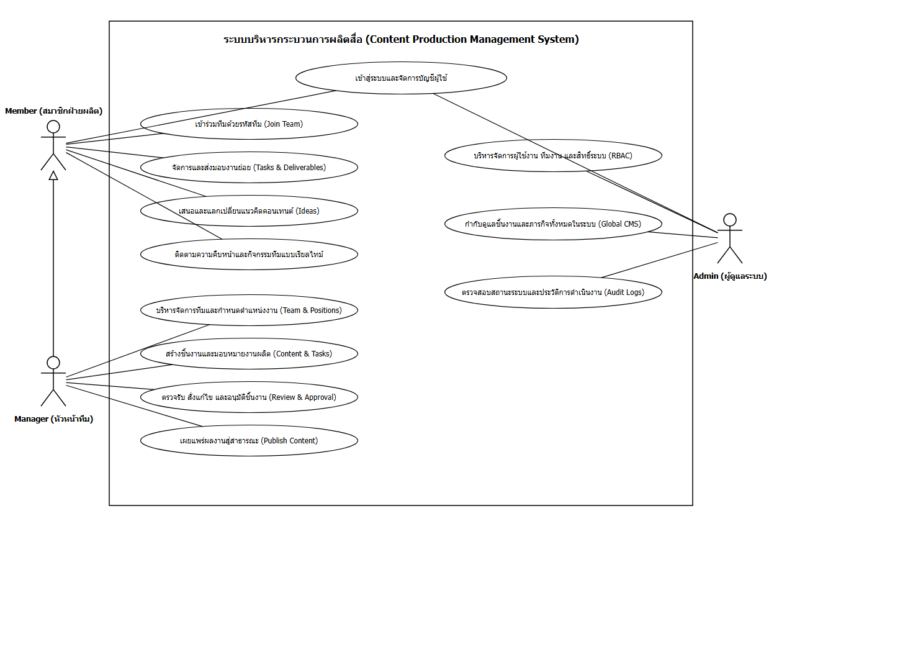
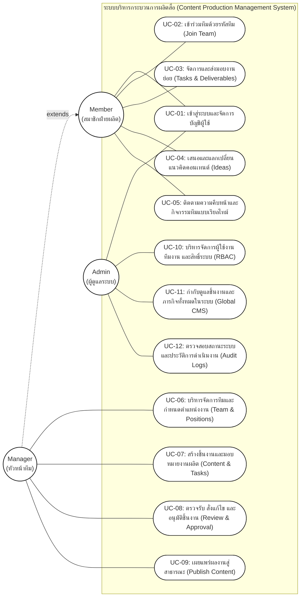

# 1. Use Case Diagram — Content Production Management System (CMS)

## ภาพรวมของระบบ (System Overview)
เอกสารนี้กำหนดขอบเขตของระบบ (System Boundary) และความสัมพันธ์ระหว่างผู้ใช้ (Actors) กับฟังก์ชันการทำงานหลัก (Use Cases) ของระบบ **Content Production Management System (Draftly)** เพื่อใช้สำหรับการวิเคราะห์และออกแบบระบบเชิงวัตถุ (OOAD) ในโครงงานระดับชั้นปีที่ 4 (Senior Capstone Project)

ระบบได้รับการปรับโครงสร้างให้กระชับ สมจริงตามการทำงานจริงในสายการผลิตสื่อ (Production Pipeline) โดยตัดความซ้ำซ้อนของ Use Case ย่อยออก และจัดกลุ่มหน้าที่ตามบทบาทผู้ใช้ 3 กลุ่มหลักอย่างชัดเจน

---

## แผนภาพ Use Case Diagram (Academic Monochrome)

> **ไฟล์ต้นฉบับสำหรับการแก้ไข:** [use-case-diagram.drawio](./diagrams/use-case-diagram.drawio)  
> รูปแบบการวาดเป็นไปตามมาตรฐาน UML 2.5 สไตล์ Academic Monochrome (ขาว-ดำ ไม่ใช้เอฟเฟกต์หรือสีสันตกแต่งเกินจำเป็น)

---

## นิยามผู้ใช้ระบบ (3 Primary Actors)

ระบบกำหนดบทบาทผู้ใช้งานออกเป็น **3 บทบาทหลัก** โดยไม่มีบทบาทนามธรรม (Generic User) แอบแฝง:

1. **Member (สมาชิกฝ่ายผลิต)**
   - ทีมงานผู้ปฏิบัติการผลิตสื่อ เช่น Creator, Video Editor, Graphic Designer, Scriptwriter
   - เข้าใช้งานผ่าน **Mobile Application**
   - เข้าร่วมทีมด้วยรหัสทีม (Team Code)
   - บริหารจัดการงานย่อยที่ได้รับมอบหมาย อัปเดตสถานะ และส่งมอบไฟล์ชิ้นงาน/ลิงก์ส่งงาน
   - เสนอแนวคิดคอนเทนต์ใหม่ (Pitch Ideas) และมีส่วนร่วมในการแสดงความคิดเห็น
   - ติดตามกิจกรรมความเคลื่อนไหวและความคืบหน้าของทีมแบบเรียลไทม์

2. **Manager (หัวหน้าทีมผู้ผลิต)**
   - ผู้ควบคุมกระบวนการผลิตสื่อและบริหารจัดการทีม (Team Leader / Producer / Editorial Head)
   - เข้าใช้งานผ่าน **Mobile Application**
   - **ความสัมพันธ์เชิงสืบทอด (Actor Generalization):** Manager สืบทอดคุณสมบัติและสิทธิ์พื้นฐานทั้งหมดของ `Member` (`Manager` $\longrightarrow^{\triangleright}$ `Member`) ทำให้สามารถเข้าสู่ระบบ ร่วมเสนอไอเดีย และติดตามความคืบหน้าของทีมได้โดยอัตโนมัติ
   - **บทบาทเฉพาะของ Manager:**
     - บริหารจัดการโครงสร้างทีม สมาชิก และกำหนดตำแหน่งงานในทีม
     - วางแผนกระบวนการผลิต สร้างชิ้นงานคอนเทนต์ (Content) และมอบหมายงานย่อย (Task Assignment)
     - ตรวจทานคุณภาพงาน สั่งแก้ไข (Request Revision) พร้อมระบุข้อเสนอแนะ และอนุมัติชิ้นงาน (1-Tap Direct Approval)
     - เผยแพร่ผลงานสู่ช่องทางสาธารณะ (Publish Content)

3. **Admin (ผู้ดูแลระบบ)**
   - ผู้บริหารจัดการระบบและกำกับดูแลความปลอดภัยระดับองค์กร (System Administrator)
   - เข้าใช้งานผ่าน **Admin Web Application (Next.js)**
   - บริหารจัดการบัญชีผู้ใช้ทั้งหมด จัดการทีม และกำหนดสิทธิ์การเข้าถึงระบบ (Role-Based Access Control - RBAC)
   - กำกับดูแลภาพรวมของคอนเทนต์และภารกิจทั้งหมดในระบบ (Global CMS Supervision)
   - ตรวจสอบสถานะระบบ การทำงานของ Server และตรวจสอบประวัติการดำเนินงานผ่าน Audit Logs

---

## รายละเอียด Use Cases ทั้ง 12 รายการ (Use Case Specifications)

| รหัส | ชื่อ Use Case (ไทย / อังกฤษ) | Actor ที่เกี่ยวข้อง | วัตถุประสงค์และขอบเขตการทำงาน |
| :--- | :--- | :--- | :--- |
| **UC-01** | **เข้าสู่ระบบและจัดการบัญชีผู้ใช้** *(Authentication & Profile Management)* | Member, Manager (สืบทอด), Admin | ยืนยันตัวตนเข้าสู่ระบบด้วย Email/Password จัดการข้อมูลส่วนตัว และความปลอดภัยของบัญชี |
| **UC-02** | **เข้าร่วมทีมด้วยรหัสทีม** *(Join Team by Code)* | Member, Manager (สืบทอด) | การเข้าร่วมพื้นที่ทำงานของทีมผลิตผ่าน Team Code (เช่น `TEAM-A`) เพื่อเข้าถึงภารกิจและทรัพยากรของทีม |
| **UC-03** | **จัดการและส่งมอบงานย่อย** *(Tasks & Deliverables Management)* | Member, Manager (สืบทอด) | สมาชิกดูงานที่ตนได้รับมอบหมาย ปรับสถานะงาน (`TODO` $\rightarrow$ `IN_PROGRESS` $\rightarrow$ `REVIEW`) แนบลิงก์ส่งมอบผลงาน (Google Drive, Frame.io) และตอบกลับคำสั่งแก้ไข |
| **UC-04** | **เสนอและแลกเปลี่ยนแนวคิดคอนเทนต์** *(Ideas & Brainstorming)* | Member, Manager (สืบทอด) | ระดมความคิด เสนอหัวข้อคอนเทนต์ใหม่เข้าสู่คลังไอเดีย และร่วมลงคะแนน/แสดงความคิดเห็นในทีม |
| **UC-05** | **ติดตามความคืบหน้าและกิจกรรมทีมแบบเรียลไทม์** *(Track Progress & Real-time Activities)* | Member, Manager (สืบทอด) | ตรวจสอบสถานะความคืบหน้าของโปรเจกต์ และรับการแจ้งเตือนกิจกรรมความเคลื่อนไหวภายในทีมแบบเรียลไทม์ |
| **UC-06** | **บริหารจัดการทีมและกำหนดตำแหน่งงาน** *(Team & Positions Management)* | Manager | หัวหน้าทีมสร้างทีม กำหนดบทบาทหน้าที่ (Positions) ให้แก่สมาชิก และดูแลความเรียบร้อยของทีม |
| **UC-07** | **สร้างชิ้นงานและมอบหมายงานผลิต** *(Content Creation & Task Assignment)* | Manager | เปิดสายการผลิตชิ้นงานคอนเทนต์ กำหนดประเภทงาน แตกงานย่อย (Sub-tasks) และมอบหมายงานให้สมาชิกผู้รับผิดชอบ |
| **UC-08** | **ตรวจรับ สั่งแก้ไข และอนุมัติชิ้นงาน** *(Review, Revision & Approval)* | Manager | ตรวจสอบไฟล์ผลงานที่สมาชิกส่งมอบ ระบุข้อความสั่งแก้ไข หรือดำเนินการอนุมัติชิ้นงานเพื่อพร้อมเผยแพร่ |
| **UC-09** | **เผยแพร่ผลงานสู่สาธารณะ** *(Publish Content)* | Manager | ดำเนินการเปลี่ยนสถานะชิ้นงานเป็นเผยแพร่แล้ว (`PUBLISHED`) พร้อมบันทึกช่องทางและลิงก์ผลงานจริง |
| **UC-10** | **บริหารจัดการผู้ใช้งาน ทีมงาน และสิทธิ์ระบบ** *(RBAC & User Administration)* | Admin | จัดการเพิ่ม/ระงับบัญชีผู้ใช้งาน จัดโครงสร้างทีม และควบคุมระดับสิทธิ์ของระบบผ่าน Web Dashboard |
| **UC-11** | **กำกับดูแลชิ้นงานและภารกิจทั้งหมดในระบบ** *(Global CMS Supervision)* | Admin | ติดตามและตรวจสอบรายการคอนเทนต์และงานผลิตทั้งหมดในระบบในมุมมองผู้ดูแลส่วนกลาง |
| **UC-12** | **ตรวจสอบสถานะระบบและประวัติการดำเนินงาน** *(System Status & Audit Logs)* | Admin | ตรวจสอบบันทึกความปลอดภัย ประวัติการทำธุรกรรมสำคัญในระบบ และสถานะความพร้อมของบริการ |

---

## โครงสร้างความสัมพันธ์ (Relationships Analysis)

1. **Actor Generalization (การสืบทอดบทบาทของผู้ใช้)**:
   - `Manager` สืบทอดมาจาก `Member` (`Manager` $\longrightarrow^{\triangleright}$ `Member`): ในเชิงสถาปัตยกรรม หัวหน้าทีมเป็นสมาชิกในทีมที่มีหน้าที่การผลิตพื้นฐานเช่นเดียวกัน จึงสืบทอด Use Case UC-01 ถึง UC-05 โดยไม่จำเป็นต้องลากเส้นเชื่อมซ้ำซ้อนข้ามกัน ซึ่งเป็นแนวทางปฏิบัติที่ดีตามมาตรฐาน UML ป้องกันปัญหาเส้นเชื่อมโยงสับสน (Spaghetti Lines)

2. **การรวมฟังก์ชันที่ทำงานเหมือนกันเข้าด้วยกัน (Consolidation)**:
   - รวมการติดตามงานย่อยและการรับแจ้งเตือนความเคลื่อนไหวเป็น Use Case เดียวคือ **UC-05: ติดตามความคืบหน้าและกิจกรรมทีมแบบเรียลไทม์**
   - รวมการอัปเดตสถานะงานและการส่งไฟล์ชิ้นงานเป็น **UC-03: จัดการและส่งมอบงานย่อย**
   - รวมกระบวนการตรวจรับ สั่งแก้ไข และอนุมัติผลงานเข้าเป็นกระบวนการต่อเนื่องใน **UC-08: ตรวจรับ สั่งแก้ไข และอนุมัติชิ้นงาน**

---

## แผนภาพ Mermaid (Structure Synchronization)

