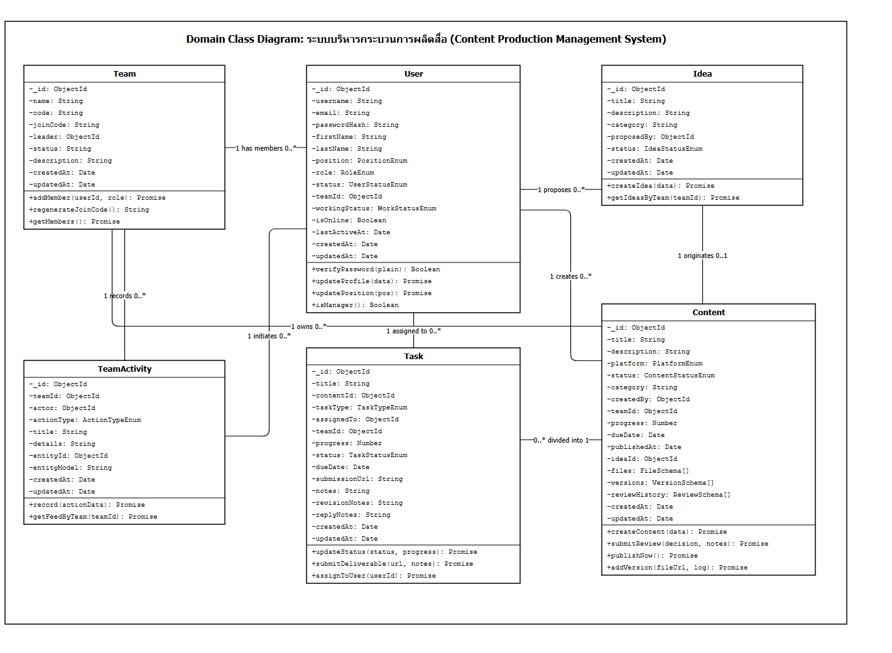

# 4. Domain Class Diagram - ระบบบริหารกระบวนการผลิตสื่อ (Content Production Management System)

เอกสารนี้ระบุโครงสร้างเชิงโครงสร้าง (Structural Modeling) ด้วยแผนภาพ Domain Class Diagram ตามมาตรฐาน UML 2.5 สำหรับสถาปัตยกรรมระบบบริหารการผลิตคอนเทนต์ โดยอ้างอิงจากโครงสร้างข้อมูลจริงของระบบ (6 โดเมนโมเดลหลักใน MongoDB) ซึ่งมีความสอดคล้องแบบหนึ่งต่อหนึ่งกับ Entity-Relationship Diagram (ERD) ทั้งในด้านเอนทิตี คุณลักษณะ (Attributes) และความสัมพันธ์ (Multiplicity)

---

## แผนภาพ Domain Class Diagram

ไฟล์ต้นฉบับสำหรับการแก้ไข: [`class-diagram.drawio`](./diagrams/class-diagram.drawio)

---

## รายละเอียดคลาสในระบบ (System Classes)

### 1. คลาส Team (ทีมงานฝ่ายผลิต)
ทำหน้าที่เก็บข้อมูลของทีมงานผลิตสื่อ และการกำหนดหัวหน้าทีม
- **Attributes:**
  - `-_id: ObjectId` (รหัสทีม)
  - `-name: String` (ชื่อทีมงาน เช่น Content Team A)
  - `-code: String` (รหัสอ้างอิงทีม เช่น TEAM-A)
  - `-joinCode: String` (รหัสเข้าร่วมทีมสำหรับสมาชิก)
  - `-leader: ObjectId` (รหัสผู้ใช้ที่เป็นหัวหน้าทีม / Manager)
  - `-status: String` (สถานะของทีม: active, suspended)
  - `-description: String` (คำอธิบายรายละเอียดทีม)
  - `-createdAt: Date` (วันเวลาที่สร้าง)
  - `-updatedAt: Date` (วันเวลาที่แก้ไขล่าสุด)
- **Methods:**
  - `+addMember(userId: ObjectId, role: String): Promise<User>`
  - `+regenerateJoinCode(): String`
  - `+getMembers(): Promise<User[]>`

---

### 2. คลาส User (ผู้ใช้งานระบบ)
ทำหน้าที่เก็บข้อมูลบัญชีผู้ใช้ สิทธิการเข้าถึง และสถานะการปฏิบัติงาน
- **Attributes:**
  - `-_id: ObjectId` (รหัสผู้ใช้)
  - `-username: String` (ชื่อบัญชีผู้ใช้)
  - `-email: String` (อีเมลเข้าใช้งาน)
  - `-passwordHash: String` (รหัสผ่านที่เข้ารหัสด้วย bcrypt)
  - `-firstName: String` (ชื่อจริง)
  - `-lastName: String` (นามสกุล)
  - `-position: PositionEnum` (ตำแหน่งวิชาชีพ: GRAPHIC, VIDEO_EDITOR, CONTENT_WRITER, SOUND_ENGINEER, GENERAL)
  - `-role: RoleEnum` (บทบาทสิทธิ์: ADMIN, MANAGER, MEMBER)
  - `-status: UserStatusEnum` (สถานะบัญชี: active, pending, inactive)
  - `-teamId: ObjectId` (รหัสทีมต้นสังกัดที่ผู้ใช้สังกัดอยู่)
  - `-workingStatus: WorkStatusEnum` (สถานะการทำงานปัจจุบัน: AVAILABLE, WORKING, REVIEWING, OFFLINE)
  - `-isOnline: Boolean` (สถานะการเชื่อมต่อเครือข่าย)
  - `-lastActiveAt: Date` (วันเวลาที่มีการเคลื่อนไหวล่าสุด)
  - `-createdAt: Date` (วันเวลาที่ลงทะเบียน)
  - `-updatedAt: Date` (วันเวลาที่แก้ไขข้อมูล)
- **Methods:**
  - `+verifyPassword(plainText: String): Boolean`
  - `+updateProfile(data: Object): Promise<User>`
  - `+updatePosition(position: String): Promise<User>`
  - `+isManager(): Boolean`

---

### 3. คลาส Idea (คลังแนวคิดคอนเทนต์)
ทำหน้าที่บันทึกไอเดียคอนเทนต์ที่สมาชิกในทีมร่วมกันเสนอ ก่อนนำไปพัฒนาเป็นชิ้นงานจริง
- **Attributes:**
  - `-_id: ObjectId` (รหัสไอเดีย)
  - `-title: String` (หัวข้อแนวคิด)
  - `-description: String` (รายละเอียดของแนวคิด)
  - `-category: String` (หมวดหมู่คอนเทนต์)
  - `-proposedBy: ObjectId` (รหัสสมาชิกผู้เสนอไอเดีย)
  - `-status: IdeaStatusEnum` (สถานะไอเดีย: PROPOSED, APPROVED, REJECTED, CONVERTED)
  - `-createdAt: Date` (วันเวลาที่เสนอไอเดีย)
  - `-updatedAt: Date` (วันเวลาที่แก้ไข)
- **Methods:**
  - `+createIdea(data: Object): Promise<Idea>`
  - `+getIdeasByTeam(teamId: ObjectId): Promise<Idea[]>`

---

### 4. คลาส Content (ชิ้นงานคอนเทนต์หลัก)
ทำหน้าที่เป็นศูนย์กลางของไปป์ไลน์การผลิตสื่อ ควบคุมสถานะความคืบหน้า ไฟล์งาน และประวัติการตรวจรับงาน
- **Attributes:**
  - `-_id: ObjectId` (รหัสชิ้นงาน)
  - `-title: String` (ชื่อชิ้นงานคอนเทนต์)
  - `-description: String` (บรีฟและรายละเอียดเนื้องาน)
  - `-platform: PlatformEnum` (แพลตฟอร์มปลายทาง: YOUTUBE, TIKTOK, FACEBOOK, INSTAGRAM, TWITTER)
  - `-status: ContentStatusEnum` (สถานะไปป์ไลน์: IDEA, PLANNING, IN_PROGRESS, REVIEW, REVISION, APPROVED, PUBLISHED)
  - `-category: String` (หมวดหมู่ของชิ้นงาน)
  - `-createdBy: ObjectId` (รหัสผู้สร้างชิ้นงาน / Manager)
  - `-teamId: ObjectId` (รหัสทีมเจ้าของชิ้นงาน)
  - `-progress: Number` (เปอร์เซ็นต์ความคืบหน้ารวม 0-100%)
  - `-dueDate: Date` (กำหนดส่งมอบงาน)
  - `-publishedAt: Date` (วันเวลาที่เผยแพร่ผลงานจริง)
  - `-ideaId: ObjectId` (รหัสไอเดียต้นทาง กรณีต่อยอดมาจาก Idea)
  - `-files: FileSchema[]` (รายการไฟล์แนบและ Asset)
  - `-versions: VersionSchema[]` (ประวัติเวอร์ชันของชิ้นงาน)
  - `-reviewHistory: ReviewSchema[]` (ประวัติการตรวจรับและสั่งแก้ไขงาน)
  - `-createdAt: Date` (วันเวลาที่สร้างชิ้นงาน)
  - `-updatedAt: Date` (วันเวลาที่อัปเดตสถานะ)
- **Methods:**
  - `+createContent(data: Object): Promise<Content>`
  - `+submitReview(decision: String, notes: String): Promise<Content>`
  - `+publishNow(): Promise<Content>`
  - `+addVersion(fileUrl: String, changeLog: String): Promise<Content>`

---

### 5. คลาส Task (ภารกิจย่อยในกระบวนการผลิต)
ทำหน้าที่แบ่งย่อยขั้นตอนการผลิตจาก Content ออกเป็นงานเฉพาะทางและมอบหมายให้สมาชิกรับผิดชอบ
- **Attributes:**
  - `-_id: ObjectId` (รหัสงานย่อย)
  - `-title: String` (ชื่องานย่อย เช่น ตัดต่อคลิปวิดีโอ, ออกแบบ Thumbnail)
  - `-contentId: ObjectId` (รหัสชิ้นงาน Content หลักที่งานนี้สังกัดอยู่)
  - `-taskType: TaskTypeEnum` (ประเภทงาน: VIDEO_EDITING, GRAPHIC_DESIGN, SCRIPTWRITING, AUDIO_MIXING, GENERAL)
  - `-assignedTo: ObjectId` (รหัสสมาชิกผู้รับผิดชอบงาน)
  - `-teamId: ObjectId` (รหัสทีมต้นสังกัด)
  - `-progress: Number` (ความคืบหน้ารายงาน 0-100%)
  - `-status: TaskStatusEnum` (สถานะงาน: TODO, IN_PROGRESS, REVIEW, REVISION, DONE)
  - `-dueDate: Date` (กำหนดส่งมอบงานย่อย)
  - `-submissionUrl: String` (ลิงก์ส่งมอบผลงาน เช่น Google Drive หรือ Cloud URL)
  - `-notes: String` (บันทึกรายละเอียดเพิ่มเติมจากผู้มอบหมาย)
  - `-revisionNotes: String` (ข้อความสั่งแก้ไขงานจาก Manager)
  - `-replyNotes: String` (ข้อความชี้แจงรอบแก้ไขจากสมาชิกผู้รับผิดชอบ)
  - `-createdAt: Date` (วันเวลาที่สร้างภารกิจ)
  - `-updatedAt: Date` (วันเวลาที่อัปเดต)
- **Methods:**
  - `+updateStatus(status: String, progress: Number): Promise<Task>`
  - `+submitDeliverable(url: String, notes: String): Promise<Task>`
  - `+assignToUser(userId: ObjectId): Promise<Task>`

---

### 6. คลาส TeamActivity (บันทึกกิจกรรมและความเคลื่อนไหวของทีม)
ทำหน้าที่บันทึกเหตุการณ์การเปลี่ยนแปลงสถานะงาน (Event Logging) เพื่อแสดงผลใน Activity Feed แบบเรียลไทม์
- **Attributes:**
  - `-_id: ObjectId` (รหัสบันทึกกิจกรรม)
  - `-teamId: ObjectId` (รหัสทีมที่เกิดกิจกรรม)
  - `-actor: ObjectId` (รหัสผู้ใช้ผู้กระทำกิจกรรม)
  - `-actionType: ActionTypeEnum` (ประเภทกิจกรรม เช่น CONTENT_CREATED, TASK_SUBMITTED, CONTENT_REVISION, CONTENT_APPROVED, CONTENT_PUBLISHED)
  - `-title: String` (หัวข้อสรุปกิจกรรม)
  - `-details: String` (รายละเอียดเพิ่มเติมของกิจกรรม)
  - `-entityId: ObjectId` (รหัสเอกสารเป้าหมาย เช่น Content ID หรือ Task ID)
  - `-entityModel: String` (ชื่อโมเดลเป้าหมาย: Content, Task, Idea)
  - `-createdAt: Date` (วันเวลาที่เกิดเหตุการณ์)
  - `-updatedAt: Date` (วันเวลาที่บันทึกข้อมูล)
- **Methods:**
  - `+record(actionData: Object): Promise<TeamActivity>`
  - `+getFeedByTeam(teamId: ObjectId): Promise<TeamActivity[]>`

---

## ความสัมพันธ์ระหว่างคลาส (Class Relationships & Multiplicity)

1. **Team (1) — has members — User (0..\*)**: ทีมหนึ่งทีมมีสมาชิกสังกัดได้หลายคน โดยผู้ใช้แต่ละคนสังกัดได้หนึ่งทีมผ่านแอตทริบิวต์ `User.teamId`
2. **Team (1) — records — TeamActivity (0..\*)**: ทีมหนึ่งทีมมีประวัติกิจกรรมบันทึกไว้ได้หลายรายการผ่าน `TeamActivity.teamId`
3. **Team (1) — owns — Content (0..\*)**: ทีมหนึ่งทีมเป็นเจ้าของชิ้นงานคอนเทนต์ได้หลายชิ้นงานผ่าน `Content.teamId`
4. **User (1) — assigned to — Task (0..\*)**: ผู้ใช้หนึ่งคนสามารถได้รับมอบหมายงานย่อยได้หลายงานผ่าน `Task.assignedTo`
5. **Content (1) — divided into — Task (0..\*)**: ชิ้นงานคอนเทนต์หนึ่งชิ้นถูกแบ่งขั้นตอนออกเป็นงานย่อยได้หลายงานผ่าน `Task.contentId`
6. **User (1) — proposes — Idea (0..\*)**: ผู้ใช้หนึ่งคนสามารถนำเสนอแนวคิดคอนเทนต์ได้หลายแนวคิดผ่าน `Idea.proposedBy`
7. **Idea (1) — originates — Content (0..1)**: แนวคิดหนึ่งแนวคิดสามารถนำไปต่อยอดสร้างเป็นคอนเทนต์ได้สูงสุดหนึ่งชิ้นงานผ่าน `Content.ideaId`
8. **User (1) — initiates — TeamActivity (0..\*)**: ผู้ใช้หนึ่งคนเป็นผู้กระทำกิจกรรมได้หลายครั้งผ่าน `TeamActivity.actor`
9. **User (1) — creates — Content (0..\*)**: ผู้ใช้ตำแหน่ง Manager หนึ่งคนสามารถสร้างชิ้นงานคอนเทนต์ได้หลายชิ้นงานผ่าน `Content.createdBy`
