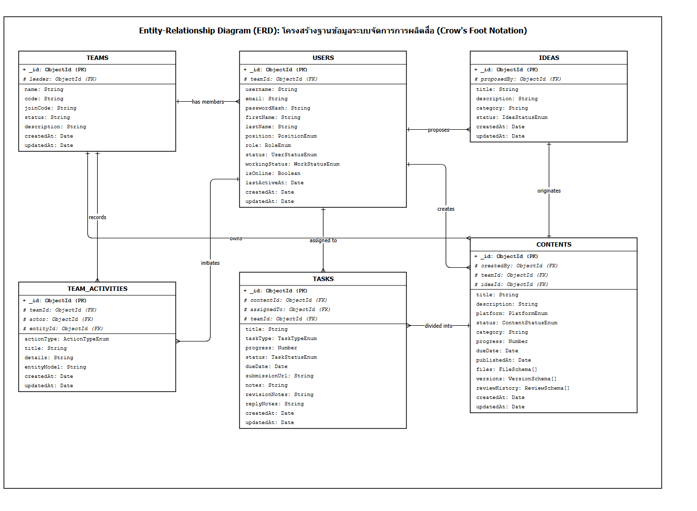

# 6. Entity-Relationship Diagram (ERD) - โครงสร้างฐานข้อมูลระบบจัดการการผลิตสื่อ

เอกสารนี้ระบุแผนภาพโครงสร้างฐานข้อมูล (Entity-Relationship Diagram - ERD) ตามมาตรฐาน **Crow's Foot Notation** โดยอ้างอิงจากแบบแผนฐานข้อมูลจริงของระบบ (MongoDB Collections) ซึ่งมีความสอดคล้องแบบหนึ่งต่อหนึ่งกับ Domain Class Diagram ทั้งในด้านเอนทิตี แอตทริบิวต์ คีย์หลัก (PK) คีย์นอก (FK) และเส้นความสัมพันธ์

---

## แผนภาพ Entity-Relationship Diagram (Crow's Foot Notation)

ไฟล์ต้นฉบับสำหรับการแก้ไข: [`er-diagram.drawio`](./diagrams/er-diagram.drawio)

---

## โครงสร้างตารางและเอนทิตี (Entities & Schema Attributes)

### 1. เอนทิตี TEAMS (ข้อมูลทีมงาน)
- `+ _id: ObjectId (PK)` - รหัสเอกลักษณ์ของทีม
- `# leader: ObjectId (FK)` - อ้างอิงไปยัง USERS._id ของหัวหน้าทีม
- `  name: String` - ชื่อทีมงานผลิตสื่อ
- `  code: String` - รหัสอ้างอิงทีม (Unique)
- `  joinCode: String` - รหัสคำเชิญเข้าร่วมทีม
- `  status: String` - สถานะการใช้งานของทีม
- `  description: String` - รายละเอียดและเป้าหมายของทีม
- `  createdAt: Date` - วันที่สร้างบันทึก
- `  updatedAt: Date` - วันที่แก้ไขล่าสุด

---

### 2. เอนทิตี USERS (ข้อมูลผู้ใช้งาน)
- `+ _id: ObjectId (PK)` - รหัสเอกลักษณ์ของผู้ใช้งาน
- `# teamId: ObjectId (FK)` - อ้างอิงไปยัง TEAMS._id ที่ผู้ใช้สังกัด
- `  username: String` - ชื่อบัญชีผู้ใช้งาน (Unique)
- `  email: String` - อีเมลสำหรับเข้าสู่ระบบ (Unique)
- `  passwordHash: String` - รหัสผ่านผ่านการแฮช
- `  firstName: String` - ชื่อจริง
- `  lastName: String` - นามสกุล
- `  position: PositionEnum` - ตำแหน่งวิชาชีพ (GRAPHIC, VIDEO_EDITOR, CONTENT_WRITER, SOUND_ENGINEER, GENERAL)
- `  role: RoleEnum` - บทบาทสิทธิ์ (ADMIN, MANAGER, MEMBER)
- `  status: UserStatusEnum` - สถานะบัญชี (active, pending, inactive)
- `  workingStatus: WorkStatusEnum` - สถานะการทำงาน (AVAILABLE, WORKING, REVIEWING, OFFLINE)
- `  isOnline: Boolean` - สถานะออนไลน์แบบเรียลไทม์
- `  lastActiveAt: Date` - เวลาการใช้งานล่าสุด
- `  createdAt: Date` - วันที่สร้างบัญชี
- `  updatedAt: Date` - วันที่แก้ไขข้อมูล

---

### 3. เอนทิตี IDEAS (คลังแนวคิดคอนเทนต์)
- `+ _id: ObjectId (PK)` - รหัสเอกลักษณ์ของแนวคิด
- `# proposedBy: ObjectId (FK)` - อ้างอิงไปยัง USERS._id ของผู้เสนอแนวคิด
- `  title: String` - ชื่อหัวข้อแนวคิด
- `  description: String` - รายละเอียดเนื้อหาแนวคิด
- `  category: String` - หมวดหมู่เนื้อหา
- `  status: IdeaStatusEnum` - สถานะของไอเดีย (PROPOSED, APPROVED, REJECTED, CONVERTED)
- `  createdAt: Date` - วันที่เสนอแนวคิด
- `  updatedAt: Date` - วันที่ปรับปรุงสถานะ

---

### 4. เอนทิตี CONTENTS (ชิ้นงานคอนเทนต์หลัก)
- `+ _id: ObjectId (PK)` - รหัสเอกลักษณ์ของชิ้นงานคอนเทนต์
- `# createdBy: ObjectId (FK)` - อ้างอิงไปยัง USERS._id ของผู้สร้างชิ้นงาน
- `# teamId: ObjectId (FK)` - อ้างอิงไปยัง TEAMS._id ของทีมเจ้าของงาน
- `# ideaId: ObjectId (FK)` - อ้างอิงไปยัง IDEAS._id (กรณีสร้างต่อยอดจากไอเดีย)
- `  title: String` - ชื่อชิ้นงานคอนเทนต์
- `  description: String` - บรีฟงานและเป้าหมายการผลิต
- `  platform: PlatformEnum` - แพลตฟอร์มปลายทาง (YOUTUBE, TIKTOK, FACEBOOK, INSTAGRAM, TWITTER)
- `  status: ContentStatusEnum` - สถานะไปป์ไลน์ (IDEA, PLANNING, IN_PROGRESS, REVIEW, REVISION, APPROVED, PUBLISHED)
- `  category: String` - หมวดหมู่ของชิ้นงาน
- `  progress: Number` - ความคืบหน้ารวมของชิ้นงาน (0-100%)
- `  dueDate: Date` - วันครบกำหนดส่งมอบ
- `  publishedAt: Date` - วันเวลาที่เผยแพร่ผลงาน
- `  files: FileSchema[]` - ข้อมูลไฟล์และ Asset แนบ
- `  versions: VersionSchema[]` - ข้อมูลประวัติเวอร์ชันงาน
- `  reviewHistory: ReviewSchema[]` - บันทึกประวัติการส่งตรวจและสั่งแก้ไข
- `  createdAt: Date` - วันที่สร้างชิ้นงาน
- `  updatedAt: Date` - วันที่อัปเดตสถานะล่าสุด

---

### 5. เอนทิตี TASKS (ภารกิจย่อยในกระบวนการผลิต)
- `+ _id: ObjectId (PK)` - รหัสเอกลักษณ์ของงานย่อย
- `# contentId: ObjectId (FK)` - อ้างอิงไปยัง CONTENTS._id ของชิ้นงานหลัก
- `# assignedTo: ObjectId (FK)` - อ้างอิงไปยัง USERS._id ของผู้รับผิดชอบงาน
- `# teamId: ObjectId (FK)` - อ้างอิงไปยัง TEAMS._id ของทีมต้นสังกัด
- `  title: String` - ชื่องานย่อย
- `  taskType: TaskTypeEnum` - ประเภทงานผลิต (VIDEO_EDITING, GRAPHIC_DESIGN, SCRIPTWRITING, AUDIO_MIXING, GENERAL)
- `  progress: Number` - ความคืบหน้าของงานย่อย (0-100%)
- `  status: TaskStatusEnum` - สถานะของงาน (TODO, IN_PROGRESS, REVIEW, REVISION, DONE)
- `  dueDate: Date` - วันครบกำหนดส่งมอบงานย่อย
- `  submissionUrl: String` - ลิงก์ส่งมอบผลงาน
- `  notes: String` - หมายเหตุเพิ่มเติม
- `  revisionNotes: String` - รายละเอียดข้อแก้ไขจากผู้ตรวจ
- `  replyNotes: String` - ข้อความชี้แจงจากผู้ปฏิบัติงาน
- `  createdAt: Date` - วันที่สร้างงานย่อย
- `  updatedAt: Date` - วันที่ปรับปรุงงาน

---

### 6. เอนทิตี TEAM_ACTIVITIES (บันทึกกิจกรรมและความเคลื่อนไหว)
- `+ _id: ObjectId (PK)` - รหัสเอกลักษณ์ของบันทึกกิจกรรม
- `# teamId: ObjectId (FK)` - อ้างอิงไปยัง TEAMS._id ที่เกิดกิจกรรม
- `# actor: ObjectId (FK)` - อ้างอิงไปยัง USERS._id ของผู้กระทำกิจกรรม
- `# entityId: ObjectId (FK)` - อ้างอิงเอกสารเป้าหมาย (เช่น Content ID หรือ Task ID)
- `  actionType: ActionTypeEnum` - รหัสประเภทกิจกรรม (CONTENT_CREATED, TASK_SUBMITTED, CONTENT_REVISION, CONTENT_APPROVED, CONTENT_PUBLISHED)
- `  title: String` - หัวข้อกิจกรรม
- `  details: String` - รายละเอียดของกิจกรรม
- `  entityModel: String` - ชื่อโมเดลที่เกี่ยวข้อง (Content, Task, Idea)
- `  createdAt: Date` - วันเวลาที่เกิดกิจกรรม
- `  updatedAt: Date` - วันเวลาที่บันทึกข้อมูล

---

## ความสัมพันธ์ระหว่างเอนทิตี (Entity Relationships)

ตารางด้านล่างแสดงความสัมพันธ์ Cardinality ตามหลักการ Crow's Foot Notation ซึ่งสอดคล้องกับ Class Diagram อย่างสมบูรณ์:

| ฝั่งต้นทาง (Source) | Cardinality | ตัวเชื่อม (Connector / FK) | ฝั่งปลายทาง (Target) | คำอธิบายความสัมพันธ์ |
|:---|:---:|:---|:---:|:---|
| **TEAMS** | 1 : 0..* | `USERS.teamId` | **USERS** | หนึ่งทีมมีสมาชิกได้ตั้งแต่ 0 ถึงหลายคน (has members) |
| **TEAMS** | 1 : 0..* | `TEAM_ACTIVITIES.teamId` | **TEAM_ACTIVITIES** | หนึ่งทีมมีบันทึกกิจกรรมได้หลายรายการ (records) |
| **TEAMS** | 1 : 0..* | `CONTENTS.teamId` | **CONTENTS** | หนึ่งทีมเป็นเจ้าของชิ้นงานคอนเทนต์ได้หลายชิ้นงาน (owns) |
| **USERS** | 1 : 0..* | `TASKS.assignedTo` | **TASKS** | หนึ่งผู้ใช้สามารถรับผิดชอบงานย่อยได้หลายงาน (assigned to) |
| **USERS** | 1 : 0..* | `IDEAS.proposedBy` | **IDEAS** | หนึ่งผู้ใช้สามารถเสนอแนวคิดได้หลายแนวคิด (proposes) |
| **USERS** | 1 : 0..* | `TEAM_ACTIVITIES.actor` | **TEAM_ACTIVITIES** | หนึ่งผู้ใช้เป็นผู้สร้างกิจกรรมได้หลายครั้ง (initiates) |
| **USERS** | 1 : 0..* | `CONTENTS.createdBy` | **CONTENTS** | หนึ่งผู้ใช้สร้างชิ้นงานคอนเทนต์ได้หลายชิ้นงาน (creates) |
| **CONTENTS** | 1 : 0..* | `TASKS.contentId` | **TASKS** | หนึ่งชิ้นงานแบ่งขั้นตอนออกเป็นงานย่อยได้หลายงาน (divided into) |
| **IDEAS** | 1 : 0..1 | `CONTENTS.ideaId` | **CONTENTS** | หนึ่งแนวคิดสามารถพัฒนาเป็นคอนเทนต์ได้สูงสุด 1 ชิ้น (originates) |
