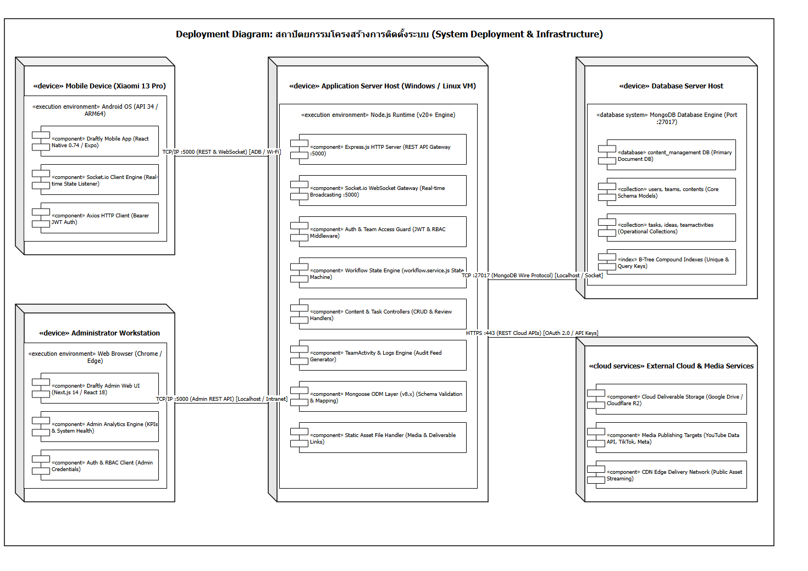

# 09. Deployment Diagram - สถาปัตยกรรมโครงสร้างการติดตั้งระบบ (System Deployment & Infrastructure)

เอกสารนี้ระบุแผนภาพสถาปัตยกรรมการติดตั้งระบบ (Deployment Diagram) ตามมาตรฐาน UML เพื่ออธิบายโครงสร้างโหนดทางกายภาพ (Physical Nodes), สภาพแวดล้อมการประมวลผล (Execution Environments), คอมโพเนนต์ซอฟต์แวร์ (Software Components), และโพรโทคอลการสื่อสารบนเครือข่าย (Communication Protocols) สำหรับระบบบริหารกระบวนการผลิตสื่อ Draftly

---

## แผนภาพ Deployment Diagram

ไฟล์ต้นฉบับสำหรับการแก้ไข: [`deployment-diagram.drawio`](./deployment-diagram.drawio)

---

## 1. ชั้นเครื่องลูกข่าย (Client Tier)

ระบบรองรับการเข้าใช้งานผ่าน 2 ช่องทางหลักตามบทบาทการทำงาน:

### 1.1 Mobile Device (อุปกรณ์เคลื่อนที่สำหรับทีมงานผลิตและหัวหน้าทีม)
- **โหนดอุปกรณ์ (Hardware Node):** สมาร์ตโฟนระบบปฏิบัติการ Android (เช่น อุปกรณ์ทดสอบหลัก: Xiaomi 13 Pro โมเดล 2210132C บนสถาปัตยกรรม ARM64)
- **สภาพแวดล้อมการทำงาน (Execution Environment):** Android OS (API Level 34+)
- **คอมโพเนนต์ภายใน:**
  - `Draftly Mobile App`: พัฒนาด้วย React Native 0.74 ร่วมกับ Expo Framework
  - `Socket.io Client Engine`: จัดการการเชื่อมต่อ WebSocket แบบสองทิศทาง (Bi-directional) เพื่อรับข้อมูล Event การอัปเดตงานแบบเรียลไทม์
  - `Axios HTTP Client`: สื่อสารข้อมูลผ่าน REST API พร้อมแนบ Bearer Token (JSON Web Token) สำหรับการยืนยันตัวตน

### 1.2 Administrator Workstation (คอมพิวเตอร์สำหรับผู้ดูแลระบบกลาง)
- **โหนดอุปกรณ์ (Hardware Node):** คอมพิวเตอร์เดสก์ท็อปหรือโน้ตบุ๊กของผู้ดูแลระบบ
- **สภาพแวดล้อมการทำงาน (Execution Environment):** โปรแกรมเว็บเบราว์เซอร์มาตรฐาน (Google Chrome, Microsoft Edge)
- **คอมโพเนนต์ภายใน:**
  - `Draftly Admin Web UI`: พัฒนาด้วย Next.js 14 และ React 18
  - `Admin Analytics Engine`: แสดงผลแดชบอร์ดสรุปสถิติการผลิต (KPI Summary) และตรวจสอบสถานะระบบ
  - `Auth & RBAC Client`: จัดการสิทธิ์ผู้ใช้งาน การจัดการทีม และการตรวจสอบ Audit Logs

---

## 2. ชั้นเครื่องแม่ข่ายบริการ (Application Server Tier)

- **โหนดแม่ข่าย (Host Node):** Application Server Host (ทำงานบนระบบปฏิบัติการ Windows / Linux VM)
- **สภาพแวดล้อมการทำงาน (Execution Environment):** Node.js Runtime (v20+ Long-Term Support Engine)
- **คอมโพเนนต์หลักที่ให้บริการบนพอร์ต 5000 (`Port :5000`):**
  - `Express.js HTTP Server`: ทำหน้าที่เป็น REST API Gateway ประมวลผลคำขอจาก Client
  - `Socket.io WebSocket Gateway`: กระจายสัญญาณเหตุการณ์แบบเรียลไทม์ (Event Broadcasting) เช่น `CONTENT_CREATED`, `TASK_SUBMITTED`, `CONTENT_REVISION`, `CONTENT_APPROVED`
  - `Auth & Team Access Guard`: มิดเดิลแวร์ตรวจสอบความถูกต้องของ JWT และป้องกันการเข้าถึงข้อมูลข้ามทีม (Team Workspace RBAC Guard)
  - `Workflow State Engine`: ให้บริการตรวจสอบกฎเกณฑ์การเปลี่ยนผ่านสถานะงานตาม State Machine (`workflow.service.js`)
  - `Content & Task Controllers`: ควบคุมการทำงานเชิงธุรกิจ (Business Logic) การส่งมอบงาน (Submission) และการตรวจรับงาน (Review/Approval)
  - `TeamActivity & Logs Engine`: บันทึกประวัติกิจกรรมของทีมเข้าสู่ฟีดกิจกรรม
  - `Mongoose ODM Layer (v8.x)`: จัดการ Object Document Mapping, Schema Validation และ Data Transformation
  - `Static Asset File Handler`: ให้บริการจัดเก็บและเข้าถึงไฟล์แนบของชิ้นงาน

---

## 3. ชั้นเครื่องแม่ข่ายฐานข้อมูล (Database Server Tier)

- **โหนดฐานข้อมูล (Database Node):** Database Server Host
- **ระบบจัดการฐานข้อมูล (Database Management System):** MongoDB Community / Enterprise Engine (พอร์ต `:27017`)
- **คอมโพเนนต์ภายใน:**
  - `content_management DB`: ฐานข้อมูลเอกสารหลักของระบบ
  - **Core Schema Collections:**
    - `users`: บัญชีผู้ใช้งาน บทบาทสิทธิ์ (Role/Position) และสถานะการปฏิบัติงาน
    - `teams`: ข้อมูลทีมงาน รหัสทีม (Code) และหัวหน้าทีม (Leader)
    - `contents`: ไปป์ไลน์ชิ้นงานคอนเทนต์ ความคืบหน้า และประวัติการตรวจรับ
  - **Operational Collections:**
    - `tasks`: ภารกิจย่อยในกระบวนการผลิตพร้อมลิงก์ส่งงาน
    - `ideas`: คลังแนวคิดคอนเทนต์
    - `teamactivities`: ประวัติการเคลื่อนไหวและกิจกรรมของทีม
  - `B-Tree Compound Indexes`: ดัชนีเพื่อเพิ่มประสิทธิภาพการค้นหาข้อมูล เช่น `{ teamId: 1, createdAt: -1 }` และ Unique Indexes สำหรับ `email`, `username`, `code`

---

## 4. ชั้นบริการภายนอก (External Cloud Services Tier)

- **โหนดบริการคลาวด์ (Cloud Services):** บริการภายนอกที่เชื่อมต่อผ่านอินเทอร์เน็ต
- **คอมโพเนนต์ที่เกี่ยวข้อง:**
  - `Cloud Deliverable Storage`: แหล่งจัดเก็บไฟล์ผลงานต้นฉบับขนาดใหญ่ (เช่น Google Drive, Cloudflare R2, Frame.io) ที่สมาชิกแนบผ่าน Submission URL
  - `Media Publishing Targets`: แพลตฟอร์มปลายทางสำหรับการเผยแพร่คอนเทนต์ (YouTube Data API v3, TikTok for Developers, Meta Graph API)
  - `CDN Edge Delivery Network`: เครือข่ายกระจายข้อมูลสาธารณะ

---

## 5. การเชื่อมต่อและโพรโทคอลเครือข่าย (Communication Network Protocols)

| เส้นทางการเชื่อมต่อ (Connection Path) | โพรโทคอลและพอร์ต (Protocol & Port) | รูปแบบความปลอดภัยและการยืนยันตัวตน | วัตถุประสงค์การใช้งาน |
|:---|:---|:---|:---|
| **Mobile App &rarr; Application Server** | TCP/IP (Port `:5000`) HTTP REST & WebSocket (WSS/WS) | Reverse Port Mapping (`adb reverse`) ในสภาพแวดล้อมพัฒนา หรือ Wi-Fi LAN / HTTPS ในสภาพแวดล้อมจริง พร้อม Bearer JWT Token | การดึงข้อมูลไปป์ไลน์, การส่งตรวจงาน, และการรับ Push Notification แบบเรียลไทม์ |
| **Admin Web &rarr; Application Server** | TCP/IP (Port `:5000`) HTTP REST API | Same-Origin / CORS, HttpOnly Session Cookie หรือ Bearer JWT | การบริหารจัดการผู้ใช้ ทีมงาน และการติดตามภาพรวมระบบผ่านเบราว์เซอร์ |
| **Application Server &rarr; Database Server** | TCP (Port `:27017`) MongoDB Wire Protocol | SCRAM-SHA-256 Authentication / Local IPC Socket | การบันทึกและสืบค้นข้อมูลเอกสารผ่าน Mongoose ODM Connection Pool |
| **Application Server &rarr; External Cloud** | HTTPS (Port `:443`) REST APIs | TLS 1.3 Encryption, OAuth 2.0 Access Token, API Key Signatures | การส่งต่อข้อมูลเผยแพร่สื่อ และการตรวจสอบความถูกต้องของ Deliverable Link |

