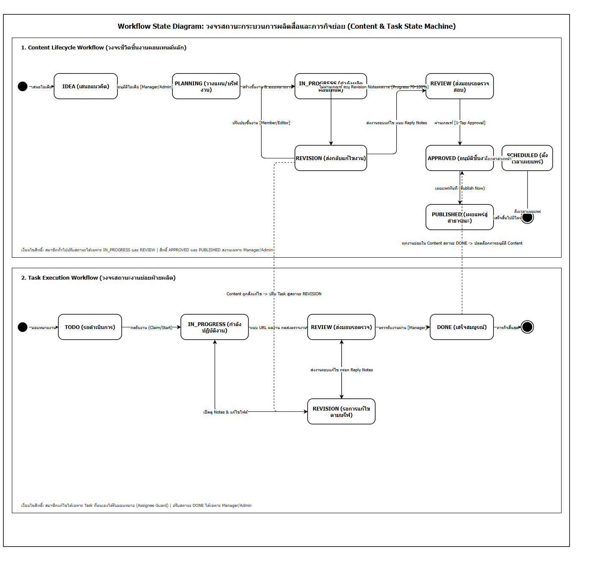

# 10. Workflow Diagram - แผนภาพวงจรสถานะการทำงาน (Content & Task State Machine)

เอกสารนี้ระบุแผนภาพวงจรสถานะการทำงาน (Workflow State Diagram) ตามมาตรฐาน UML State Machine เพื่ออธิบายสถานะ (States), เงื่อนไขการเปลี่ยนผ่าน (Transitions), และข้อกำหนดด้านสิทธิ์ (Guard Conditions) ของกระบวนการผลิตสื่อในระบบ Draftly โดยอ้างอิงจากบริการ State Machine จริงในระบบ (`master/backend/src/services/workflow.service.js`)

---

## แผนภาพ Workflow State Diagram

ไฟล์ต้นฉบับสำหรับการแก้ไข: [`workflow-diagram.drawio`](./workflow-diagram.drawio)

---

## 1. วงจรชีวิตชิ้นงานคอนเทนต์หลัก (Content Lifecycle Workflow)

ชิ้นงานคอนเทนต์ (Content) มีวงจรสถานะหลัก 7 สถานะ ดังต่อไปนี้:

| สถานะ (Status) | คำอธิบาย | ผู้มีสิทธิ์เปลี่ยนสถานะ (Permitted Roles) | สถานะถัดไปที่อนุญาต (Next Allowed States) |
|:---|:---|:---|:---|
| **IDEA** | แนวคิดคอนเทนต์ที่ถูกเสนอเข้ามาในคลังไอเดีย | ADMIN, MANAGER | `PLANNING` |
| **PLANNING** | ขั้นตอนการบรีฟงาน วางแผน และแตกงานย่อย (Tasks) | ADMIN, MANAGER, MEMBER | `IN_PROGRESS` |
| **IN_PROGRESS** | ชิ้นงานกำลังอยู่ในขั้นตอนการผลิตโดยทีมงาน | ADMIN, MANAGER, MEMBER | `REVIEW`, `PLANNING` |
| **REVIEW** | งานถูกส่งมอบเข้าสู่คิวรอการตรวจสอบคุณภาพโดยหัวหน้าทีม | ADMIN, MANAGER | `APPROVED`, `REVISION` |
| **REVISION** | งานไม่ผ่านเกณฑ์ ถูกส่งกลับพร้อมข้อความสั่งแก้ (Revision Notes) | ADMIN, MANAGER, MEMBER | `IN_PROGRESS`, `REVIEW` |
| **APPROVED** | ชิ้นงานผ่านการตรวจรับ 100% พร้อมสำหรับการเผยแพร่ | ADMIN, MANAGER | `PUBLISHED`, `SCHEDULED` |
| **SCHEDULED** | ชิ้นงานถูกตั้งเวลาเผยแพร่อัตโนมัติตามกำหนด | ADMIN, MANAGER | `PUBLISHED` |
| **PUBLISHED** | ชิ้นงานถูกเผยแพร่สู่สาธารณะเรียบร้อยแล้ว (สถานะสิ้นสุด) | - | - |

---

## 2. วงจรสถานะงานย่อยฝ่ายผลิต (Task Execution Workflow)

ภารกิจย่อย (Task) ในการผลิตสื่อ (เช่น การตัดต่อวิดีโอ, การออกแบบภาพกราฟิก, การเขียนบท) มีวงจรสถานะ 5 สถานะ:

| สถานะ (Status) | คำอธิบาย | ผู้มีสิทธิ์เปลี่ยนสถานะ (Permitted Roles) | สถานะถัดไปที่อนุญาต (Next Allowed States) |
|:---|:---|:---|:---|
| **TODO** | งานย่อยถูกสร้างและมอบหมายให้สมาชิกในทีมรอดำเนินการ | ADMIN, MANAGER, MEMBER | `IN_PROGRESS` |
| **IN_PROGRESS** | สมาชิกกดรับงานและกำลังดำเนินการผลิตตามบรีฟ | ADMIN, MANAGER, MEMBER | `REVIEW`, `TODO` |
| **REVIEW** | สมาชิกแนบ Submission URL และกดส่งตรวจงาน | ADMIN, MANAGER | `DONE`, `REVISION`, `IN_PROGRESS` |
| **REVISION** | หัวหน้าทีมสั่งแก้ไขงาน สมาชิกเปิดดูคำแนะนำและแก้ไข | ADMIN, MANAGER, MEMBER | `IN_PROGRESS`, `REVIEW` |
| **DONE** | หัวหน้าทีมตรวจรับผลงานเรียบร้อยแล้ว (เสร็จสมบูรณ์) | ADMIN, MANAGER | `REVIEW` (กรณีต้องการ Re-open) |

---

## 3. การประสานงานและการควบคุมสิทธิ์ (Coordination & Guards)

### 3.1 การเชื่อมโยงสถานะระหว่าง Content และ Tasks (State Synchronization)
1. **การปลดล็อกการอนุมัติ (Approval Unlocking):**
   - ชิ้นงาน Content จะผ่านการอนุมัติ (`APPROVED`) ได้อย่างสมบูรณ์ เมื่อภารกิจย่อยทั้งหมดที่สังกัดอยู่ใน Content นั้นมีสถานะเป็น `DONE` (ความคืบหน้ารวมคำนวณเป็น 100%)
2. **การกระจายสถานะแก้ไข (Cascading Revision):**
   - เมื่อ Manager สั่งแก้ไขที่ระดับ Content สถานะของงานย่อยที่เกี่ยวข้องจะถูกปรับเป็น `REVISION` ควบคู่กัน พร้อมบันทึก `revisionNotes` เพื่อให้ผู้รับผิดชอบงานทราบจุดบกพร่องทันที
3. **การส่งงานรอบแก้ไขพร้อมข้อชี้แจง (Resubmission with Reply Notes):**
   - สมาชิกผู้รับผิดชอบงานสามารถส่งงานรอบใหม่ได้โดยตรงจากสถานะ `REVISION` ไปเป็น `REVIEW` พร้อมกรอกข้อความ `replyNotes` เพื่ออธิบายแนวทางการปรับปรุงให้ Manager ทราบ

### 3.2 กฎการรักษาความปลอดภัยและการเป็นเจ้าของงาน (Ownership & Guard Rules)
- **Task Assignee Guard:** สมาชิกบทบาท `MEMBER` สามารถปรับปรุงความคืบหน้า แนบ URL ผลงาน หรือส่งตรวจได้เฉพาะงานย่อยที่ตนเองถูกระบุชื่อเป็นผู้รับผิดชอบ (`Task.assignedTo == req.user.id`) เท่านั้น
- **Approval Role Guard:** การอนุมัติงาน (`APPROVED` หรือ `DONE`) และการเผยแพร่ผลงานสู่สาธารณะ (`PUBLISHED`) ถูกสงวนไว้ให้เฉพาะผู้ใช้บทบาท `MANAGER` และ `ADMIN` เท่านั้น
- **Team Isolation Guard:** ข้อมูลและการเปลี่ยนสถานะทั้งหมดถูกจำกัดขอบเขตให้อยู่เฉพาะภายในทีมตนเอง (`Team Isolation`) ป้องกันการแก้ไขงานข้ามทีม

