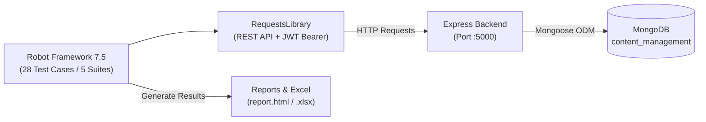

# 12. รายงานการทดสอบอัตโนมัติด้วย Robot Framework ตาม Use Case (Automated Acceptance Testing Report)

เอกสารนี้ระบุรายละเอียดการวางแผนการทดสอบ (Test Plan), สรุปสถานการณ์การทดสอบ (Test Scenario Summary), รายละเอียดกรณีทดสอบอัตโนมัติ 28 รายการ (Automated Test Cases: Valid 14 + Invalid 14) และรายงานสรุปผลการรันจริง (Test Execution Report) ด้วย **Robot Framework 7.5** สำหรับระบบ **Draftly (Content Production Management System)** โดยอ้างอิงตรงตามผัง **Use Case Diagram ทั้ง 14 Use Cases (`UC-01` ถึง `UC-14`)**

---

## ส่วนที่ 1: การวางแผนการทดสอบอัตโนมัติ (Automated Test Plan)

### 1.1 สถาปัตยกรรมและแนวคิดการทดสอบอัตโนมัติ (Testing Architecture)
ชุดการทดสอบอัตโนมัติพัฒนาขึ้นด้วยแนวคิด **Keyword-Driven Testing** โดยใช้ `Robot Framework 7.5` ร่วมกับ `RequestsLibrary` ยิงคำขอ HTTP ไปยัง Express Backend Server (`http://127.0.0.1:5000/api`) และฐานข้อมูลจริง `MongoDB (content_management)` พร้อมเปิดใช้งานโหมดป้องกันการเขียนทับไฟล์ฐานข้อมูลพกพา (`DISABLE_DB_AUTO_EXPORT=true`) และมีกระบวนการทำความสะอาดข้อมูลทดสอบ (`Suite Teardown` และ `db:import --force`) หลังรันเสร็จสิ้น



### 1.2 ตารางกำหนดการดำเนินการทดสอบอัตโนมัติ (Testing Schedule)

| ลำดับ | กิจกรรม (Testing Activity) | รายละเอียดการดำเนินงาน | เครื่องมือ / ไฟล์ที่เกี่ยวข้อง | ผู้รับผิดชอบ | ระยะเวลา |
| :---: | :--- | :--- | :--- | :---: | :---: |
| **1** | วิเคราะห์ Use Case และกำหนด Test Scenario | วิเคราะห์ความต้องการจาก `UC-01` ถึง `UC-14` เพื่อออกแบบ `TS_001` – `TS_014` ครอบคลุมทั้งกรณีข้อมูลถูกต้อง (Valid) และข้อมูลผิดพลาด/ไม่มีสิทธิ์ (Invalid) | `01-Use-Case-Diagram.md`, `02-Use-Case-Descriptions.md` | ผู้พัฒนา / QA | 2 วัน |
| **2** | พัฒนา Reusable Keywords และ Variables | สร้างโครงสร้าง Keyword-Driven สำหรับเข้าสู่ระบบ แนบ JWT Bearer Token และตรวจสอบโครงสร้าง JSON Response | `tests/robot/resources/*.resource` | ผู้พัฒนา / QA | 2 วัน |
| **3** | เขียนสคริปต์กรณีทดสอบอัตโนมัติ 28 ข้อ | พัฒนาไฟล์ `.robot` ทั้ง 5 ชุดการทดสอบ (`TC_AUTO_001` ถึง `TC_AUTO_028`) จับคู่ตรงกับ 14 Use Cases (Valid 14 + Invalid 14) | `tests/robot/testcases/01..05_*.robot` | ผู้พัฒนา / QA | 3 วัน |
| **4** | รันชุดการทดสอบกับเซิร์ฟเวอร์และฐานข้อมูลจริง | รัน Robot Framework ทั้ง 28 ข้อกับ Express API และ MongoDB จริง พร้อมตรวจสอบ HTTP Status Code และ Payload | `.venv\Scripts\robot`, `master/backend` | ผู้พัฒนา / QA | 1 วัน |
| **5** | คืนค่าฐานข้อมูลสะอาดและสรุปรายงานผล | ทำความสะอาดข้อมูลทดสอบให้คงเหลือ 33 เรคคอร์ดมาตรฐาน และออกรายงาน `report.html`, `log.html` และไฟล์ Excel | `tests/robot/results/report.html`, `Draftly-Automated-Tests-By-UseCase.xlsx` | ผู้พัฒนา / QA | 1 วัน |

### 1.3 สภาพแวดล้อมและเครื่องมือที่ใช้ในการทดสอบ (Test Environment)
- **Test Engine:** Robot Framework 7.5 (`Python 3.14` บน `.venv`)
- **HTTP Client Library:** `robotframework-requests` 0.9.7 (`requests` 2.34.2)
- **Target API Server:** Node.js + Express.js (`http://127.0.0.1:5000/api`)
- **Database:** MongoDB Community Server 7.0 (`mongodb://127.0.0.1:27017/content_management`)
- **Database Hygiene Guard:** `DISABLE_DB_AUTO_EXPORT=true` และ `npm --prefix master/backend run db:import -- --force`

---

## ส่วนที่ 2: สรุปสถานการณ์การทดสอบอัตโนมัติ (Test Scenario Summary)

ตารางสรุปความเชื่อมโยงระหว่าง **Use Case (`UC-01` – `UC-14`)**, **Test Scenario (`TS_001` – `TS_014`)**, และ **รหัสการทดสอบอัตโนมัติ (`TC_AUTO_001` – `TC_AUTO_028`)**:

| Scenario ID | Use Case ID | ชื่อสถานการณ์การทดสอบ (Test Scenario Name) | บทบาทหลัก (Actor) | รหัสกรณีทดสอบ (Valid / Invalid) | ไฟล์ชุดการทดสอบ (Robot Suite) | จำนวนเคส |
| :---: | :---: | :--- | :---: | :---: | :--- | :---: |
| **TS_001** | **UC-01** | การลงทะเบียนผู้ใช้งานใหม่ (User Registration) | Member | `TC_AUTO_001` (Valid)<br>`TC_AUTO_002` (Invalid) | `01_authentication_tests.robot` | 2 |
| **TS_002** | **UC-02** | การเข้าสู่ระบบและยืนยันตัวตน (User Login & JWT) | Member, Manager, Admin | `TC_AUTO_003` (Valid)<br>`TC_AUTO_004` (Invalid) | `01_authentication_tests.robot` | 2 |
| **TS_003** | **UC-03** | การจัดการบัญชีส่วนตัว (Personal Account Management) | Member, Manager, Admin | `TC_AUTO_005` (Valid)<br>`TC_AUTO_006` (Invalid) | `01_authentication_tests.robot` | 2 |
| **TS_004** | **UC-04** | การเข้าร่วมทีมด้วยรหัสทีม (Join Team by Code) | Member (Manager สืบทอด) | `TC_AUTO_007` (Valid)<br>`TC_AUTO_008` (Invalid) | `02_team_workspace_tests.robot` | 2 |
| **TS_005** | **UC-05** | การจัดการและส่งมอบงานย่อย (Sub-task Submission) | Member | `TC_AUTO_009` (Valid)<br>`TC_AUTO_010` (Invalid) | `03_content_production_workflow_tests.robot` | 2 |
| **TS_006** | **UC-06** | การเสนอและแลกเปลี่ยนแนวคิดคอนเทนต์ (Pitch Ideas) | Member (Manager สืบทอด) | `TC_AUTO_011` (Valid)<br>`TC_AUTO_012` (Invalid) | `04_ideas_brainstorming_tests.robot` | 2 |
| **TS_007** | **UC-07** | การติดตามความคืบหน้าและกิจกรรมทีมแบบเรียลไทม์ | Member (Manager สืบทอด) | `TC_AUTO_013` (Valid)<br>`TC_AUTO_014` (Invalid) | `02_team_workspace_tests.robot` | 2 |
| **TS_008** | **UC-08** | การบริหารจัดการทีมและกำหนดตำแหน่งงาน | Manager | `TC_AUTO_015` (Valid)<br>`TC_AUTO_016` (Invalid) | `02_team_workspace_tests.robot` | 2 |
| **TS_009** | **UC-09** | การสร้างชิ้นงานและมอบหมายงานผลิต | Manager | `TC_AUTO_017` (Valid)<br>`TC_AUTO_018` (Invalid) | `03_content_production_workflow_tests.robot` | 2 |
| **TS_010** | **UC-10** | การตรวจรับ สั่งแก้ไข และอนุมัติชิ้นงาน (1-Tap Approval) | Manager | `TC_AUTO_019` (Valid)<br>`TC_AUTO_020` (Invalid) | `03_content_production_workflow_tests.robot` | 2 |
| **TS_011** | **UC-11** | การเผยแพร่ผลงานสู่สาธารณะ (Publish Content) | Manager | `TC_AUTO_021` (Valid)<br>`TC_AUTO_022` (Invalid) | `03_content_production_workflow_tests.robot` | 2 |
| **TS_012** | **UC-12** | การบริหารจัดการผู้ใช้งาน ทีมงาน และสิทธิ์ระบบ | Admin | `TC_AUTO_023` (Valid)<br>`TC_AUTO_024` (Invalid) | `05_admin_and_security_tests.robot` | 2 |
| **TS_013** | **UC-13** | การกำกับดูแลชิ้นงานและภารกิจทั้งหมดในระบบ (Global CMS) | Admin | `TC_AUTO_025` (Valid)<br>`TC_AUTO_026` (Invalid) | `05_admin_and_security_tests.robot` | 2 |
| **TS_014** | **UC-14** | การตรวจสอบสถานะระบบและประวัติการดำเนินงาน (Audit Logs) | Admin | `TC_AUTO_027` (Valid)<br>`TC_AUTO_028` (Invalid) | `05_admin_and_security_tests.robot` | 2 |
| **รวม** | **14 UCs** | **ครอบคลุมครบทุกฟังก์ชันตาม Use Case Diagram** | **ครบทั้ง 3 บทบาท** | **Valid 14 + Invalid 14** | **5 ชุดการทดสอบ (.robot)** | **28** |

---

## ส่วนที่ 3: รายละเอียดกรณีทดสอบอัตโนมัติ (Automated Test Case Specification)

| Test Case ID | Scenario / UC | ประเภท | ชื่อกรณีทดสอบ (Test Case Name) | ขั้นตอนอัตโนมัติ & Endpoint | ข้อมูลทดสอบ (Payload / Input) | ผลลัพธ์ที่คาดหวัง (Expected Result) | ผลลัพธ์ที่ได้จริง (Actual Result) | สถานะ |
| :---: | :---: | :---: | :--- | :--- | :--- | :--- | :--- | :---: |
| **TC_AUTO_001** | `TS_001`<br>(`UC-01`) | Valid | ลงทะเบียนผู้ใช้งานใหม่สำเร็จด้วยข้อมูลครบถ้วน | `POST /api/auth/register` พร้อมลบผู้ใช้ทดสอบหลังจบเคส | `firstName="Auto"`, `email="auto_uc01_*@studio.com"`, `teamCode="TEAM-A"` | ได้รับ HTTP `201 Created`, ออก JWT Token, `role=MEMBER`, `teamCode=TEAM-A` | ได้รับ HTTP `201 Created` พร้อม JWT Token และลบข้อมูลทดสอบเรียบร้อย | **PASS** |
| **TC_AUTO_002** | `TS_001`<br>(`UC-01`) | Invalid | ปฏิเสธการลงทะเบียนกรณีใช้อีเมลซ้ำหรือข้อมูลไม่ครบ | `POST /api/auth/register` ด้วยอีเมลซ้ำและรหัสผ่านว่าง | `email="member@studio.com"` และ `password=""` | ระบบปฏิเสธด้วยรหัส HTTP `400 Bad Request` ทั้ง 2 กรณี | ได้รับ HTTP `400 Bad Request` ป้องกันอีเมลซ้ำและข้อมูลว่างสำเร็จ | **PASS** |
| **TC_AUTO_003** | `TS_002`<br>(`UC-02`) | Valid | เข้าสู่ระบบสำเร็จครบทั้ง 3 บทบาท (Admin, Manager, Member) | `POST /api/auth/login` ทั้ง 3 บัญชีหลัก | `admin@studio.com`, `manager@studio.com`, `member@studio.com` (`123456`) | ได้รับ HTTP `200 OK` พร้อม JWT Token และระบุ `role` ตรงตามบัญชี | ได้รับ HTTP `200 OK` และตรวจสอบสิทธิ์ `ADMIN`, `MANAGER`, `MEMBER` ถูกต้อง | **PASS** |
| **TC_AUTO_004** | `TS_002`<br>(`UC-02`) | Invalid | ปฏิเสธการเข้าสู่ระบบเมื่อรหัสผ่านผิดหรือไม่มีอีเมลในระบบ | `POST /api/auth/login` ด้วยรหัสผ่านผิดและอีเมลปลอม | `password="wrongpass999"` และ `email="ghost@studio.com"` | ระบบปฏิเสธด้วยรหัส HTTP `401 Unauthorized` และไม่ออก Token | ได้รับ HTTP `401 Unauthorized` ทั้ง 2 กรณี | **PASS** |
| **TC_AUTO_005** | `TS_003`<br>(`UC-03`) | Valid | เรียกดูและอัปเดตข้อมูลโปรไฟล์ส่วนตัวสำเร็จ | `GET /api/auth/me` และ `PUT /api/users/:id` (พร้อมคืนค่าเดิม) | `firstName="Member Updated"`, `position="Editor"` | ได้รับ HTTP `200 OK` อัปเดตข้อมูลโปรไฟล์และคืนค่าเดิมสำเร็จ | ได้รับ HTTP `200 OK` ข้อมูลอัปเดตและคืนค่ากลับเป็นค่าเริ่มต้นเรียบร้อย | **PASS** |
| **TC_AUTO_006** | `TS_003`<br>(`UC-03`) | Invalid | ปฏิเสธการแก้ไขโปรไฟล์เมื่อส่งชื่อว่างหรือไม่แนบ Token | `PUT /api/users/:id` (ชื่อว่าง) และ `GET /api/auth/me` (ไม่มี Token) | `firstName=""` และไม่ส่ง `Authorization` Header | ได้รับ HTTP `400 Bad Request` เมื่อชื่อว่าง และ HTTP `403` เมื่อไม่มี Token | ได้รับ HTTP `400` และ HTTP `403` ตามเงื่อนไขความปลอดภัย | **PASS** |
| **TC_AUTO_007** | `TS_004`<br>(`UC-04`) | Valid | เข้าร่วมทีมด้วยรหัสทีมที่ถูกต้อง (`TEAM-A`) สำเร็จ | `POST /api/teams/join` และ `GET /api/teams/my-teams` | `joinCode="TEAM-A"` | ได้รับ HTTP `200 OK` ผู้ใช้สังกัดทีม Content Team A (`TEAM-A`) | ได้รับ HTTP `200 OK` และแสดงข้อมูลทีม `TEAM-A` ครบถ้วน | **PASS** |
| **TC_AUTO_008** | `TS_004`<br>(`UC-04`) | Invalid | ปฏิเสธการเข้าร่วมทีมเมื่อกรอกรหัสทีมผิดหรือส่งค่าว่าง | `POST /api/teams/join` ด้วยรหัสผิดและค่าว่าง | `joinCode="INVALID-CODE-999"` และ `joinCode=""` | ได้รับ HTTP `404 Not Found` (รหัสผิด) และ HTTP `400 Bad Request` (ค่าว่าง) | ได้รับ HTTP `404` และ HTTP `400` ป้องกันการเข้าร่วมทีมผิดพลาดสำเร็จ | **PASS** |
| **TC_AUTO_009** | `TS_005`<br>(`UC-05`) | Valid | สมาชิกเปลี่ยนสถานะงานย่อยเป็น `IN_PROGRESS` และส่งลิงก์เข้า `REVIEW` | `PATCH /api/tasks/:id/status` | `status="IN_PROGRESS"` -> `status="REVIEW"`, `submissionUrl="https://drive.google.com/..."` | ได้รับ HTTP `200 OK` สถานะเปลี่ยนเป็น `REVIEW` และบันทึก URL ผลงาน | ได้รับ HTTP `200 OK` บันทึกสถานะและลิงก์ผลงาน Google Drive ถูกต้อง | **PASS** |
| **TC_AUTO_010** | `TS_005`<br>(`UC-05`) | Invalid | ปฏิเสธการส่งมอบงานย่อยเข้า `REVIEW` หากไม่แนบลิงก์ผลงาน | `PATCH /api/tasks/:id/status` โดยเว้นว่างลิงก์และหมายเหตุ | `status="REVIEW"`, `submissionUrl=""`, `replyNotes=""` | ระบบปฏิเสธด้วยรหัส HTTP `400 Bad Request` | ได้รับ HTTP `400 Bad Request` ป้องกันการส่งงานว่างเปล่าสำเร็จ | **PASS** |
| **TC_AUTO_011** | `TS_006`<br>(`UC-06`) | Valid | เสนอแนวคิดคอนเทนต์ใหม่ ดูบอร์ดไอเดีย และอนุมัติไอเดียสำเร็จ | `POST /api/ideas`, `GET /api/ideas`, `PUT /api/ideas/:id` | `title="Robot Brainstorm Idea"`, `status="APPROVED"` | ได้รับ HTTP `201` และ `200` ครบทุกขั้นตอน พร้อมลบไอเดียทดสอบใน Teardown | ได้รับ HTTP `201` และ `200` อนุมัติไอเดียและลบข้อมูลทดสอบเรียบร้อย | **PASS** |
| **TC_AUTO_012** | `TS_006`<br>(`UC-06`) | Invalid | ปฏิเสธการสร้างแนวคิดคอนเทนต์เมื่อเว้นว่างหัวข้อหรือไม่แนบ Token | `POST /api/ideas` (หัวข้อว่าง และไม่แนบ Token) | `title=""` และไม่มี `Authorization` Header | ได้รับ HTTP `400 Bad Request` (หัวข้อว่าง) และ HTTP `403` (ไม่มี Token) | ได้รับ HTTP `400` และ HTTP `403` ตามที่กำหนด | **PASS** |
| **TC_AUTO_013** | `TS_007`<br>(`UC-07`) | Valid | ติดตามความคืบหน้าภาพรวม (Dashboard) และ Activity Feed ของทีม | `GET /api/teams/:teamA_Id/dashboard` และ `/activities` | `teamId=<TEAM_A_ID>` | ได้รับ HTTP `200 OK` พร้อมข้อมูลสถิติความคืบหน้าและรายการกิจกรรมของทีม | ได้รับ HTTP `200 OK` ข้อมูล Dashboard และ Activity Feed ครบถ้วน | **PASS** |
| **TC_AUTO_014** | `TS_007`<br>(`UC-07`) | Invalid | ป้องกันสมาชิกเข้าถึง Dashboard และกิจกรรมของทีมอื่น (Team Isolation) | `GET /api/teams/:teamB_Id/dashboard` และ `/activities` (ใช้ Token ทีม A) | `teamId=<TEAM_B_ID>` (ข้ามทีม) | ระบบปฏิเสธด้วยรหัส HTTP `403 Forbidden` ทั้ง 2 รายการ | ได้รับ HTTP `403 Forbidden` ยืนยันการทำงานของ Team Isolation Guard | **PASS** |
| **TC_AUTO_015** | `TS_008`<br>(`UC-08`) | Valid | Manager ดูรายชื่อสมาชิกในทีมและกำหนดตำแหน่งงานฝ่ายผลิตสำเร็จ | `GET /api/users?teamId=:id` และ `PUT /api/users/:memberId` | `position="Video Editor"` (พร้อมคืนค่าเดิม) | ได้รับ HTTP `200 OK` อัปเดตตำแหน่งงานฝ่ายผลิตและคืนค่าเดิมสำเร็จ | ได้รับ HTTP `200 OK` กำหนดตำแหน่งและคืนค่าเดิมเรียบร้อย | **PASS** |
| **TC_AUTO_016** | `TS_008`<br>(`UC-08`) | Invalid | ปฏิเสธการดึงรายชื่อสมาชิกข้ามทีมโดย Manager ต่างสังกัด | `GET /api/users?teamId=:teamB_Id` (ด้วย Token ของ Manager ทีม A) | `teamId=<TEAM_B_ID>` | ระบบปฏิเสธด้วยรหัส HTTP `403 Forbidden` | ได้รับ HTTP `403 Forbidden` ป้องกันการดูสมาชิกข้ามทีมสำเร็จ | **PASS** |
| **TC_AUTO_017** | `TS_009`<br>(`UC-09`) | Valid | Manager สร้างชิ้นงานใหม่และมอบหมายภารกิจงานย่อยให้สมาชิกสำเร็จ | `POST /api/contents` และ `POST /api/tasks` | `title="Robot E2E Production Content"`, `assigneeId=<MEMBER_ID>` | ได้รับ HTTP `201 Created` ทั้งการสร้าง Content และ Sub-task | ได้รับ HTTP `201 Created` ทั้ง 2 รายการและเชื่อมโยงข้อมูลถูกต้อง | **PASS** |
| **TC_AUTO_018** | `TS_009`<br>(`UC-09`) | Invalid | ปฏิเสธการสร้างชิ้นงานหรือภารกิจงานย่อยเมื่อไม่ระบุชื่อเรื่อง | `POST /api/contents` และ `POST /api/tasks` โดยเว้นว่าง `title` | `title=""` | ระบบปฏิเสธด้วยรหัส HTTP `400 Bad Request` ทั้ง 2 รายการ | ได้รับ HTTP `400 Bad Request` ทั้งการสร้าง Content และ Task ชื่อว่าง | **PASS** |
| **TC_AUTO_019** | `TS_010`<br>(`UC-10`) | Valid | Manager สั่งแก้ไขงาน (`REVISION`) และอนุมัติแบบ 1-Tap (`APPROVED`) | `POST /api/contents/:id/review` (`REVISION` -> `APPROVED`) | `decision="REVISION"`, `notes="Adjust audio"` -> `decision="APPROVED"` | ได้รับ HTTP `200 OK` เมื่ออนุมัติแล้ว Content เป็น `APPROVED` และ Task เป็น `DONE` | ได้รับ HTTP `200 OK` ซิงค์สถานะ Content เป็น `APPROVED` และ Task เป็น `DONE` | **PASS** |
| **TC_AUTO_020** | `TS_010`<br>(`UC-10`) | Invalid | ปฏิเสธการสั่งแก้ไขโดยไม่ระบุหมายเหตุ และการอนุมัติงานโดยสิทธิ์ Member | `POST /api/contents/:id/review` (Notes ว่าง และใช้ Token ของ Member) | `decision="REVISION", notes=""` และ Member กด `APPROVED` | ได้รับ HTTP `400 Bad Request` (ไม่มีหมายเหตุ) และ HTTP `403 Forbidden` (Member) | ได้รับ HTTP `400` และ HTTP `403` ป้องกันการตรวจงานผิดเงื่อนไขสำเร็จ | **PASS** |
| **TC_AUTO_021** | `TS_011`<br>(`UC-11`) | Valid | Manager เผยแพร่ผลงานที่อนุมัติแล้วสู่สาธารณะ (`PUBLISHED`) สำเร็จ | `PATCH /api/contents/:id/status` (พร้อมลบข้อมูลใน Suite Teardown) | `status="PUBLISHED"` | ได้รับ HTTP `200 OK` สถานะเปลี่ยนเป็น `PUBLISHED` และลบข้อมูลทดสอบเรียบร้อย | ได้รับ HTTP `200 OK` สถานะเป็น `PUBLISHED` และทำความสะอาดฐานข้อมูลสำเร็จ | **PASS** |
| **TC_AUTO_022** | `TS_011`<br>(`UC-11`) | Invalid | ปฏิเสธการเผยแพร่ผลงานโดยสิทธิ์ Member หรือรหัสชิ้นงานไม่มีอยู่จริง | `PATCH /api/contents/:id/status` (สิทธิ์ Member และ ID ไม่มีในระบบ) | Member Token และ Content ID `000000000000000000000000` | ได้รับ HTTP `403 Forbidden` (Member) และ HTTP `404 Not Found` (ไม่มี ID) | ได้รับ HTTP `403` และ HTTP `404` ตรงตามที่คาดหวัง | **PASS** |
| **TC_AUTO_023** | `TS_012`<br>(`UC-12`) | Valid | Admin ดูรายชื่อผู้ใช้ทั้งหมดและบริหารจัดการสร้าง/ลบทีมงานสำเร็จ | `GET /api/users`, `POST /api/teams`, `DELETE /api/teams/:id` | `name="Robot Temp Team"`, `code="RBT-99"` | ได้รับ HTTP `200` และ `201` สร้างและลบทีมทดสอบเรียบร้อย | ได้รับ HTTP `200` และ `201` ครบทุกขั้นตอนโดยไม่ทิ้งข้อมูลขยะ | **PASS** |
| **TC_AUTO_024** | `TS_012`<br>(`UC-12`) | Invalid | ปฏิเสธการสร้างทีมด้วยรหัสซ้ำ (`TEAM-A`) และการเข้าถึงผู้ใช้ทั้งหมดด้วยสิทธิ์ Member | `POST /api/teams` (รหัสซ้ำ) และ `GET /api/users` (สิทธิ์ Member) | `code="TEAM-A"` และใช้ Member Token ดึงผู้ใช้ทั้งระบบ | ได้รับ HTTP `400 Bad Request` (รหัสซ้ำ) และ HTTP `403 Forbidden` (สิทธิ์ Member) | ได้รับ HTTP `400` และ HTTP `403` ตามกฎการควบคุมสิทธิ์ | **PASS** |
| **TC_AUTO_025** | `TS_013`<br>(`UC-13`) | Valid | Admin กำกับดูแลชิ้นงานและภารกิจทั้งหมดในระบบแบบส่วนกลาง (Global CMS) | `GET /api/contents` และ `GET /api/tasks` (ด้วย Admin Token) | Admin Global Scope (`teamId=null`) | ได้รับ HTTP `200 OK` แสดงรายการคอนเทนต์และภารกิจของทุกทีมรวมกัน | ได้รับ HTTP `200 OK` ดึงข้อมูลคอนเทนต์และภารกิจทั้งระบบสำเร็จ | **PASS** |
| **TC_AUTO_026** | `TS_013`<br>(`UC-13`) | Invalid | ปฏิเสธการแก้ไขหรือลบชิ้นงานด้วยรหัส ObjectId ที่ไม่มีอยู่จริงในระบบ | `PUT /api/contents/:id` และ `DELETE /api/contents/:id` | ObjectId `000000000000000000000000` | ได้รับ HTTP `404 Not Found` ทั้งการแก้ไขและการลบ | ได้รับ HTTP `404 Not Found` ทั้ง 2 คำขอ | **PASS** |
| **TC_AUTO_027** | `TS_014`<br>(`UC-14`) | Valid | Admin ตรวจสอบสถานะระบบ (`/api/health`) และเรียกดูประวัติ Audit Logs | `GET /api/health` และ `GET /api/audit-logs` | Admin Bearer Token | ได้รับ HTTP `200 OK` สถานะ `ok=true` และดึงรายการ Audit Logs สำเร็จ | ได้รับ HTTP `200 OK` ทั้ง Health Check และ Audit Logs | **PASS** |
| **TC_AUTO_028** | `TS_014`<br>(`UC-14`) | Invalid | ปฏิเสธการเข้าถึง Audit Logs กรณีเป็นสมาชิกทั่วไปหรือใช้ Token ไม่ถูกต้อง | `GET /api/audit-logs` (Member Token / ไม่มี Token / Token ปลอม) | Member Token, Missing Token, Invalid JWT | ได้รับ HTTP `403 Forbidden` (Member/Missing) และ HTTP `401 Unauthorized` (Invalid JWT) | ได้รับ HTTP `403` และ HTTP `401` ป้องกันการเข้าถึงบันทึกความปลอดภัยสำเร็จ | **PASS** |

---

## ส่วนที่ 4: รายงานสรุปผลการทดสอบอัตโนมัติ (Test Execution Report)

### 4.1 สรุปผลการรันแยกตามไฟล์ชุดการทดสอบ (Suite Execution Summary)

| ลำดับ | ชุดการทดสอบ (Robot Test Suite) | Use Cases ที่ครอบคลุม | รหัสกรณีทดสอบ | จำนวนเคส | ผ่าน (Passed) | ไม่ผ่าน (Failed) | อัตราผ่าน (Pass Rate) |
| :---: | :--- | :---: | :--- | :---: | :---: | :---: | :---: |
| **1** | `01_authentication_tests.robot` | `UC-01`, `UC-02`, `UC-03` | `TC_AUTO_001` – `TC_AUTO_006` | 6 | 6 | 0 | **100%** |
| **2** | `02_team_workspace_tests.robot` | `UC-04`, `UC-07`, `UC-08` | `TC_AUTO_007` – `TC_AUTO_008`, `TC_AUTO_013` – `TC_AUTO_016` | 6 | 6 | 0 | **100%** |
| **3** | `03_content_production_workflow_tests.robot` | `UC-05`, `UC-09`, `UC-10`, `UC-11` | `TC_AUTO_009` – `TC_AUTO_010`, `TC_AUTO_017` – `TC_AUTO_022` | 8 | 8 | 0 | **100%** |
| **4** | `04_ideas_brainstorming_tests.robot` | `UC-06` | `TC_AUTO_011` – `TC_AUTO_012` | 2 | 2 | 0 | **100%** |
| **5** | `05_admin_and_security_tests.robot` | `UC-12`, `UC-13`, `UC-14` | `TC_AUTO_023` – `TC_AUTO_028` | 6 | 6 | 0 | **100%** |
| **รวม** | **5 ชุดการทดสอบ (All Suites)** | **ครบทั้ง 14 Use Cases** | **`TC_AUTO_001` – `TC_AUTO_028`** | **28** | **28** | **0** | **100%** |

### 4.2 คำสั่งสำหรับรันชุดการทดสอบอัตโนมัติ (Execution Commands)

```powershell
# 1. รันชุดการทดสอบอัตโนมัติทั้ง 28 ข้อ พร้อมสร้างรายงาน HTML/XML
.\.venv\Scripts\python.exe -m robot -d tests/robot/results tests/robot/testcases/

# 2. คืนค่าฐานข้อมูลมาตรฐาน 33 เรคคอร์ดหลังการทดสอบ (กรณีไม่ได้เปิด DISABLE_DB_AUTO_EXPORT)
npm --prefix master/backend run db:import -- --force
```

### 4.3 ไฟล์รายงานและสเปรดชีตที่เกี่ยวข้อง (Generated Reports & Excel Workbooks)
- **รายงาน HTML จาก Robot Framework:**
  - `tests/robot/results/report.html` (รายงานสรุปภาพรวมสีเขียว 28 Passed / 0 Failed)
  - `tests/robot/results/log.html` (บันทึกขั้นตอนการยิง API และ JSON Payload รายบรรทัด)
  - `tests/robot/results/output.xml` (ไฟล์ผลลัพธ์โครงสร้าง XML มาตรฐาน)
- **ไฟล์ Excel สรุปผลการทดสอบระบบ (`docs/academic/spreadsheets/`):**
  - [Draftly-Automated-Tests-By-UseCase.xlsx](./spreadsheets/Draftly-Automated-Tests-By-UseCase.xlsx): สเปรดชีตการทดสอบอัตโนมัติตาม Use Case ครบทั้ง 4 ส่วน (`1. Test Plan`, `2. Test Scenario Summary`, `3. Automated Test Cases`, `4. Test Report`)
  - [Draftly-System-Test-Cases-14-UseCases.xlsx](./spreadsheets/Draftly-System-Test-Cases-14-UseCases.xlsx): สเปรดชีตรวม Manual Test Cases (20 ข้อ) + Robot Automated Tests (28 ข้อ) และตาราง Traceability Matrix (RTM)
