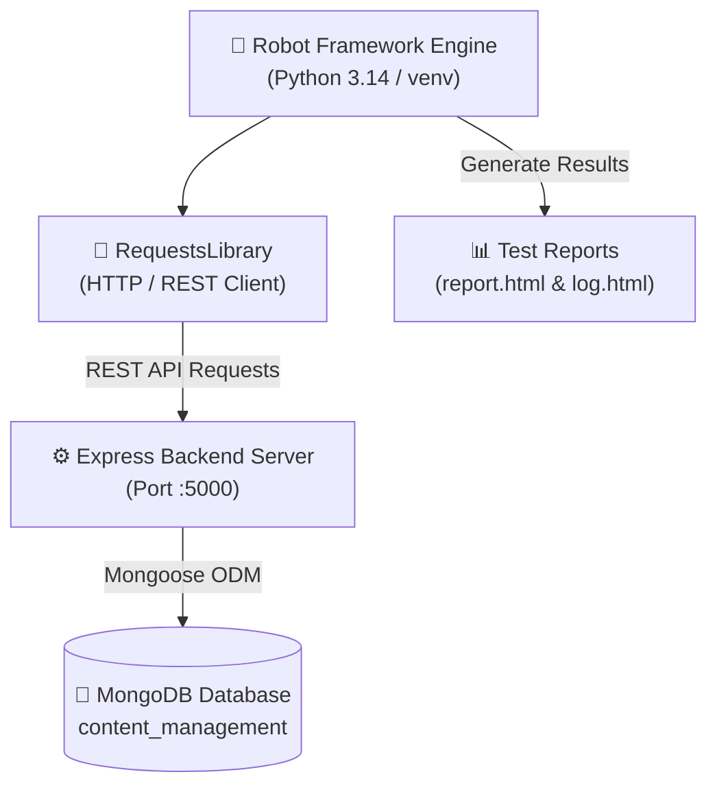

# 12. ชุดการทดสอบอัตโนมัติด้วย Robot Framework (Automated Acceptance Testing)

เอกสารนี้ระบุรายละเอียดสถาปัตยกรรม วิธีการรัน และสรุปผลการทดสอบระบบอัตโนมัติ (Automated Acceptance Testing) ด้วย **Robot Framework** สำหรับระบบ **Draftly (Content Production Management System)** ตามมาตรฐานวิศวกรรมซอฟต์แวร์ เพื่อใช้ประกอบการประเมินคุณภาพซอฟต์แวร์ในโครงงานระดับชั้นปีที่ 4 (Senior Capstone Project)

---

## 1. ภาพรวมและสถาปัตยกรรมชุดการทดสอบ (Testing Architecture)

ชุดการทดสอบอัตโนมัตินี้ใช้แนวคิด **Keyword-Driven Testing** เพื่อทดสอบฟังก์ชันการทำงานจริงของ Backend API, วงจรสถานะการผลิตสื่อ (Content & Task Workflow Lifecycle), การจัดการสิทธิ์ (Role-Based Access Control - RBAC), และการแบ่งแยกข้อมูลระหว่างทีม (Team Isolation Guard)



### สภาพแวดล้อมและไลบรารีที่ใช้ (Environment & Libraries)
- **Test Engine:** Robot Framework 7.5
- **HTTP Client Library:** `robotframework-requests` 0.9.7 (พร้อม `requests` 2.34.2)
- **Runtime:** Python 3.14 (Virtual Environment `.venv`)
- **เป้าหมายการทดสอบ:** Draftly API Server (`http://127.0.0.1:5000`) เชื่อมต่อฐานข้อมูล MongoDB จริง

---

## 2. โครงสร้างของชุดการทดสอบ (Test Suite Structure)

```text
tests/
└── robot/
    ├── resources/                      # Reusable Keywords และ Variables
    │   ├── variables.resource          # ตัวแปร URL บัญชีผู้ใช้ รหัสทีม
    │   ├── auth_keywords.resource      # การยืนยันตัวตน และ JWT Headers
    │   ├── team_keywords.resource      # การเข้าร่วมทีม และ Team Dashboard
    │   ├── workflow_keywords.resource  # วงจรสร้างงาน ตรวจงาน สั่งแก้ อนุมัติ เผยแพร่
    │   └── admin_keywords.resource     # สิทธิ์แอดมิน การดึงประวัติ และ Audit Logs
    ├── testcases/                      # ไฟล์ชุดกรณีทดสอบ (.robot)
    │   ├── 01_authentication_tests.robot
    │   ├── 02_team_workspace_tests.robot
    │   ├── 03_content_production_workflow_tests.robot
    │   ├── 04_ideas_brainstorming_tests.robot
    │   └── 05_admin_and_security_tests.robot
    └── results/                        # รายงานผลการทดสอบอัตโนมัติ (HTML)
        ├── report.html                 # สรุปภาพรวมและสถิติ Pass/Fail
        ├── log.html                    # บันทึกขั้นตอนและ Payload อย่างละเอียด
        └── output.xml                  # ข้อมูลผลลัพธ์โครงสร้าง XML
```

---

## 3. สรุปรายการกรณีทดสอบอัตโนมัติทั้ง 26 รายการ (26 Automated Test Cases)

### Suite 1: Authentication & Health (`01_authentication_tests.robot`) — 6 รายการ
- `TC_AUTH_01:` ตรวจสอบสถานะความพร้อมของเซิร์ฟเวอร์และการเชื่อมต่อ MongoDB (`/api/health`)
- `TC_AUTH_02:` เข้าสู่ระบบในบทบาท Administrator (`admin@studio.com`) และตรวจสอบ Token Claim
- `TC_AUTH_03:` เข้าสู่ระบบในบทบาท Production Manager (`manager@studio.com`)
- `TC_AUTH_04:` เข้าสู่ระบบในบทบาท Production Member (`member@studio.com`)
- `TC_AUTH_05:` ปฏิเสธการเข้าสู่ระบบกรณีรหัสผ่านผิด (Negative Test: HTTP 401 Unauthorized)
- `TC_AUTH_06:` ตรวจสอบการเข้าถึง Protected Route ด้วย Bearer JWT (`/api/auth/me`)

### Suite 2: Team Workspace & Activities (`02_team_workspace_tests.robot`) — 5 รายการ
- `TC_TEAM_01:` สมาชิกดึงข้อมูลโปรไฟล์และสังกัดทีมของตนเอง (`/api/teams/my-team`)
- `TC_TEAM_02:` เข้าร่วมทีมสำเร็จด้วยรหัสทีมที่ถูกต้อง (`TEAM-A`)
- `TC_TEAM_03:` ปฏิเสธการเข้าร่วมทีมกรณีรหัสไม่ถูกต้อง (Negative Test: HTTP 400 Bad Request)
- `TC_TEAM_04:` เรียกดูข้อมูลสรุปภาพรวม KPI และสถิติของทีม (Team Dashboard Aggregates)
- `TC_TEAM_05:` เรียกดูกระแสกิจกรรมสดของทีมตามลำดับเวลา (Chronological Activity Feed)

### Suite 3: Content Production Workflow Lifecycle (`03_content_production_workflow_tests.robot`) — 7 รายการ
- `TC_WORKFLOW_01:` Manager สร้าง Content Pipeline ใหม่ และมอบหมาย Task ให้แก่ Member
- `TC_WORKFLOW_02:` Member เปลี่ยนสถานะงานย่อยเป็น `IN_PROGRESS`
- `TC_WORKFLOW_03:` Member ส่งมอบผลงานพร้อมแนบลิงก์ Google Drive ปรับสถานะ Content และ Task เป็น `REVIEW`
- `TC_WORKFLOW_04:` Manager ตรวจสอบงานแล้วสั่งแก้ไข (Revision) พร้อมส่งข้อความ Revision Notes
- `TC_WORKFLOW_05:` Member ส่งงานรอบแก้ไขพร้อมข้อความตอบกลับชี้แจง (Reply Notes)
- `TC_WORKFLOW_06:` Manager ดำเนินการอนุมัติชิ้นงานแบบ 1-Tap (Content ปรับเป็น `APPROVED` และซิงค์ Task เป็น `DONE` 100%)
- `TC_WORKFLOW_07:` Manager เผยแพร่ผลงานสู่สาธารณะ ปรับสถานะ Content เป็น `PUBLISHED`

### Suite 4: Ideas & Brainstorming (`04_ideas_brainstorming_tests.robot`) — 3 รายการ
- `TC_IDEA_01:` Member เสนอแนวคิดคอนเทนต์ใหม่เข้าสู่คลังไอเดียในสถานะ `DRAFT`
- `TC_IDEA_02:` เรียกดูรายการไอเดียทั้งหมดบนบอร์ดของทีม
- `TC_IDEA_03:` Manager ประเมินและอนุมัติไอเดียเป็นสถานะ `APPROVED`

### Suite 5: Admin Governance & Security Isolation (`05_admin_and_security_tests.robot`) — 5 รายการ
- `TC_ADMIN_01:` Admin เรียกดูรายชื่อผู้ใช้งานทั้งหมดในระบบ (`/api/users`)
- `TC_ADMIN_02:` Admin เรียกดูรายการคอนเทนต์ทั้งหมดของระบบแบบภาพรวมส่วนกลาง (Global CMS)
- `TC_ADMIN_03:` Admin เรียกดูบันทึกความปลอดภัยและประวัติการดำเนินงาน (Audit Logs)
- `TC_ADMIN_04:` ตรวจสอบสิทธิ์ RBAC: ปฏิเสธไม่ให้ Member เข้าถึง API ผู้ใช้ของ Admin (HTTP 403 Forbidden)
- `TC_ADMIN_05:` ตรวจสอบ Team Isolation Guard: ปฏิเสธไม่ให้สมาชิกทีม B เข้าถึงข้อมูลของทีม A (HTTP 403 Forbidden)

---

## 4. วิธีการรันชุดการทดสอบ (Execution Guide)

### คำสั่งรันการทดสอบทั้งหมด (Run All Suites):
```bash
.venv\Scripts\python -m robot -d tests/robot/results tests/robot/testcases/
```

### คำสั่งรันเฉพาะชุดการทดสอบที่ต้องการ (Run Specific Suite):
```bash
# ทดสอบเฉพาะกระบวนการผลิตสื่อ (Content Workflow)
.venv\Scripts\python -m robot -d tests/robot/results tests/robot/testcases/03_content_production_workflow_tests.robot

# ทดสอบเฉพาะความปลอดภัยและสิทธิ์ Admin
.venv\Scripts\python -m robot -d tests/robot/results tests/robot/testcases/05_admin_and_security_tests.robot
```

---

## 5. ผลการทดสอบ (Execution Results)

ผลการทดสอบจริงเมื่อรันกับระบบ Draftly API Server:

| ชุดการทดสอบ (Test Suite) | จำนวนการทดสอบ (Tests) | ผ่าน (Passed) | ไม่ผ่าน (Failed) | อัตราความสำเร็จ (Pass Rate) |
| :--- | :---: | :---: | :---: | :---: |
| **01 Authentication Tests** | 6 | 6 | 0 | **100%** |
| **02 Team Workspace Tests** | 5 | 5 | 0 | **100%** |
| **03 Content Production Workflow Tests** | 7 | 7 | 0 | **100%** |
| **04 Ideas Brainstorming Tests** | 3 | 3 | 0 | **100%** |
| **05 Admin And Security Tests** | 5 | 5 | 0 | **100%** |
| **รวมทั้งหมด (Total)** | **26** | **26** | **0** | **100%** |

> **รายงานผลการทดสอบ HTML (เปิดดูผ่านเบราว์เซอร์):**
> - สรุปผลภาพรวม: `tests/robot/results/report.html`
> - บันทึกขั้นตอนและ Payload ละเอียด: `tests/robot/results/log.html`
